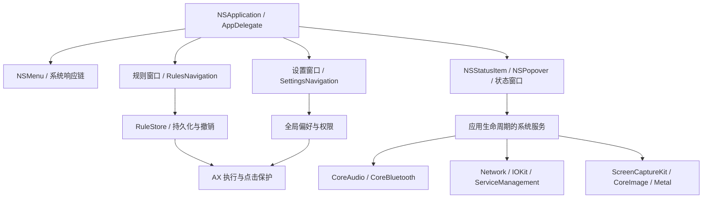

# Blinker 原生重构

2026-10-07。目标系统 macOS 26–27。此记录区分已经实现、已经验证和仍待迁移，不能作为全应用验收通过证明。

## 结构

原来“同一管理窗口里切换两套 NavigationSplitView”的约束停止使用。规则、设置和面板是三种不同任务，不再用手工页签模拟同一个工作区。普通单应用编辑仍在规则窗口右侧，不增加编辑弹窗。

- 应用生命周期：AppKit `NSApplication.run`，明确持有 `AppDelegate`；删除 SwiftUI 空 Settings 场景和启动绕行。26 的 `NSHostingSceneRepresentation` 注册真正的规则/设置 WindowGroup，按稳定值复用窗口。
- 应用菜单：`NSMenu`，编辑命令交给响应链；⌘1 复用规则窗口，⌘N 添加应用，⌘, 复用设置窗口，⌘W 关闭当前窗口，⌘Q 正常退出。
- 规则窗口：`NavigationSplitView`、原生 List、`.searchable(placement: .sidebar)`、Form；选择、过滤和添加 sheet 有独立状态。
- 设置窗口：固定的一套侧栏和详情，通用/权限在首组；外部深链选中对应页面。打开设置保留上次页面，不重置为通用。
- 两个窗口的侧栏收放：macOS 26 `DefaultToolbarItem(kind: .sidebarToggle)`，系统提供行为、外形和键盘语义；删除手工按钮封装。
- 状态与快速操作：共享服务的紧凑面板；26 使用原生 segmented Picker，27 使用 SDK 确认存在的 `.tabs`；不再手工组合多个玻璃按钮冒充页签。
- 窗口预览：原生 bordered/borderedProminent 按钮表达选择，删除自定义 ButtonStyle 的按压缩放。缩略图是内容，不是自绘控件外壳。
- 长任务、权限、扫描、电源命令仍由应用生命周期服务持有；关闭视图不会悄悄取消已经接受的系统操作。

## 系统接口清单

| 能力 | 当前接口 / 处置 | 边界 |
|---|---|---|
| 窗口、菜单、侧栏、搜索、表单 | AppKit + SwiftUI 系统容器；26 DefaultToolbarItem、27 tabs | 不画窗口边框，不复制系统动画；27 分支尚无实机验收 |
| 悬停玻璃、浮层 | NSGlassEffectView / NSGlassEffectContainerView | 系统材质已使用；悬停彩色面与按压反馈仍有自绘，不能标为全部原生 |
| 应用启动 / 屏保 | 本轮从 `/usr/bin/open` 迁移到 `NSWorkspace.openApplication` async | 异步错误传给同一 ScreenActionController；测试不实际启动屏保 |
| 跨应用窗口操作 | AXUIElement、CGEvent、NSWorkspace | 这些 API 年代早，但仍是当前实现所需的系统接口；不为“新”改成脚本或虚构替代 |
| 窗口截图与屏幕效果 | ScreenCaptureKit、CoreImage、MetalKit | 保留既有权限、背压和取消边界；屏幕视觉效果属于软件功能 |
| 音频 | CoreAudio，硬件属性监听 | 已是系统原生能力；保留不可调音量设备和设备消失处理 |
| 网络 | Network/NWPathMonitor、CoreWLAN、CoreLocation | Wi-Fi 名称授权与连接状态分开，不因打开面板主动索取权限 |
| 电池 / 保持唤醒 | IOKit power sources、IOPMAssertion | 保留采样节流和断电状态，不能为视觉改写服务 |
| 登录项 / 低电量写入 | SMAppService、NSXPCConnection、授权 helper、pmset | 低电量读取与写入不是同一权限；禁止直接在 View 中启动提权任务 |
| 蓝牙 | CoreBluetooth、IOBluetooth，部分 system_profiler / HID 补充 | 不承诺所有设备均提供电量；保持未知、未连接、读取中状态 |
| 工作区跨 Space 恢复 | SkyLight 私有符号 | 保留实验标记和能力探测；不是“macOS 27 公开新 API” |
| 锁屏 | login.framework 私有符号 | 单独封装并探测可用性；无证据时不声明稳定公开替代 |
| Finder 开关 / 系统外观 / 清空废纸篓 | 系统工具或 AppleScript | 仍是专门适配层，失败/自动化权限明确反馈；本轮没有冒充已迁移 |
| 分辨率 | CoreGraphics display APIs | 保留显示器模式验证与失败反馈 |

依据：[NSHostingSceneRepresentation](https://developer.apple.com/documentation/swiftui/nshostingscenerepresentation)、[Apple Liquid Glass](https://developer.apple.com/documentation/technologyoverviews/adopting-liquid-glass)、[DefaultToolbarItem](https://developer.apple.com/documentation/swiftui/defaulttoolbaritem)、[NSWorkspace](https://developer.apple.com/documentation/appkit/nsworkspace)。27 专用符号同时核对本机 MacOSX 27.0 SDK 声明，不能把能编译当作在 27 上已经验证。

## 数据和迁移

RuleStore、规则编码、偏好 key、撤销/重做、权限策略及 AX 执行边界不变。规则和设置分别使用稳定 scene ID 与固定窗口值，由系统保留各自窗口状态。搜索与规则选择不再存放于 SettingsNavigation，避免诊断跳转覆盖编辑上下文。

任务开始前的源代码快照和 tracked diff 位于 `/private/tmp/blinker-rebuild-baseline/`。独立预览使用单独 bundle ID；不替换已安装应用，不请求额外系统权限，不覆盖用户现有规则。

## 待完成的原生迁移

1. 悬停按钮移除自绘彩色面和缩放反馈，改用系统 NSButton glass bezel；需要同时保留和验证保护点击、长按、拖出、快速重新进入、禁用和关闭面板的回归覆盖。
2. 窗口预览自定义淡入淡出交给系统呈现；需要确认原有切换体验和快速关闭再打开没有回归。
3. 浮层字号、预览整体 scale、HUD 固定高度、权限助手等辅助 surface 逐项审查；主窗口的新结构不证明这些已完成。
4. 深浅色、最小尺寸、减少动态/透明度、VoiceOver、英文长标题和 macOS 27 实机检查。

前两项被自动审批拒绝，理由是可能移除既有动画并削弱悬停回归覆盖。相关悬停外观试改已撤回，原动画及测试保留。未经进一步确认不把这部分标记为完成。

## 244039 原生应用壳重构（2026-10-07）

- 实际仓库 `/Users/ygnan/Projects/Code/Blinker`，dev；未提交、未替换正式安装。
- 最终预览 `/private/tmp/Blinker-scene-rebuild.app`，bundle ID `com.example.Blinker.sceneRebuild`。
- AppKit 生命周期 + macOS 26 `NSHostingSceneRepresentation`；规则/设置为独立、按固定值复用的 WindowGroup。普通 NSHostingController 中默认 sidebar item 未呈现的问题，通过真正场景托管解决，没有补回自绘按钮。
- 系统 sidebar toggle、searchable、原生 Picker；删除手工玻璃导航组合；窗口预览按钮改用系统样式；屏保改用 NSWorkspace async。
- 本机 macOS 26.6.2（25G83），SDK 27.0。244038 全量 273 Core + 367 App = 640 测试通过，未删既有悬停测试。244039 只修正空工具栏占位与规则窗口标题，最终 build、297 文件 strict lint、diff check 通过。
- 244037/244038 原生实测：首次启动、⌘1、⌘,、原生侧栏收放；添加应用 sheet / 取消 / 添加测试用备忘录规则；直接编辑；Notes 搜索与选择跨规则/设置窗口保留；设置窗口缩至最小宽度，说明换行、垂直滚动正常。测试规则只写入隔离预览 UserDefaults。
- 244039 已重新打开，AX 确认设置工具栏存在“打开状态面板”真实按钮，截图确认空占位消失；用户已在预览中切到悬停设置页。
- 当前未验证：27 实机、完整浅深色及辅助功能组合、重构版系统状态面板完整路径、真实跨应用 AX 点击与私有能力。不得把之前版本的渲染记录算作新版本全量通过。
- 悬停自绘外观与预览自定义淡入淡出迁移被自动审批拒绝；本轮相关试改已还原至任务开始快照，原动画和全部保护测试保留。其他后续项见 native-rebuild.md。
